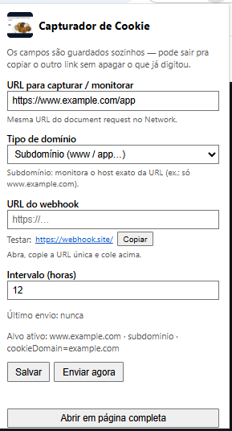
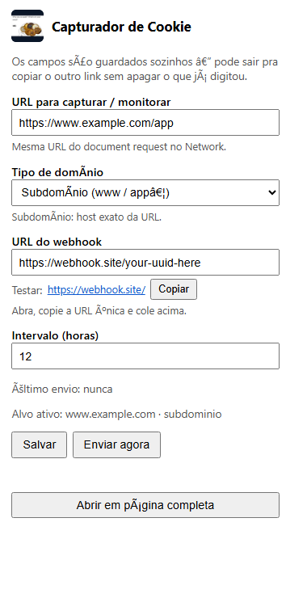
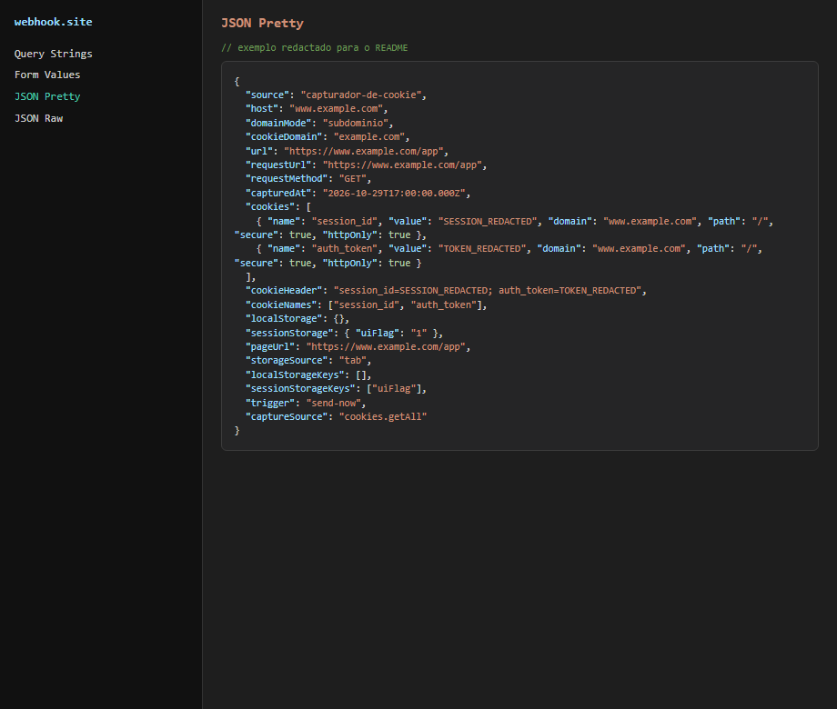

# Capturador de Cookie

Extensão Chrome **Manifest V3** que captura o header `Cookie` completo da sua sessão (igual ao DevTools → Network) **e** o `localStorage` / `sessionStorage` da aba aberta, e envia um `POST` JSON para um **webhook configurável**.

O alvo padrão de exemplo é `https://www.example.com/app`. Na prática você configura a **URL de captura** e se é **domínio principal** ou **subdomínio** nas Opções (não precisa editar código).

Uso típico: renovar sessão em automações (n8n, Make, API própria, webhook.site para teste).

| | |
|---|---|
| **Repo** | https://github.com/fsaisystem-ops/capturador-de-cookie |
| **Versão** | 1.7.0 (ver `manifest.json`) |
| **Escopo** | Sessão **sua** / automação autorizada. Não é ferramenta para coletar sessão de terceiros. |

## Índice

- [Instalação](#instalação)
- [Configuração](#configuração)
- [Quando dispara](#quando-dispara)
- [Domínio principal vs subdomínio](#domínio-principal-vs-subdomínio)
- [Payload do webhook](#payload-do-webhook)
- [Arquivos](#arquivos)
- [Desenvolvimento e testes](#desenvolvimento-e-testes)
- [Troubleshooting](#troubleshooting)
- [Privacidade](#privacidade)
- [Documentação extra](#documentação-extra)

## Instalação

1. Clone ou baixe o repositório.
2. Abra `chrome://extensions`.
3. Ative **Modo do desenvolvedor** (canto superior direito).
4. Clique em **Carregar sem compactação** → escolha a pasta do projeto (a que contém o `manifest.json`).
5. A extensão **Capturador de Cookie** aparece na lista (como abaixo).
6. Clique com o **botão esquerdo** no ícone da extensão (toolbar) para abrir o painel de configuração (popup).

**Chrome — carregar a extensão**



**Tela inicial da extensão** (popup ao clicar no ícone)



Depois de atualizar o código no disco: em `chrome://extensions`, clique **Recarregar** na extensão (obrigatório se mudou `permissions` / `manifest`).

## Configuração

1. **URL para capturar / monitorar** — ex.: `https://www.example.com/app` (a mesma do Network).
2. **Tipo de domínio**
   - **Subdomínio** — monitora o host exato da URL (`www.example.com`).
   - **Domínio principal** — trata o registrável (`example.com`) e hosts sob ele (ver [Domínio principal vs subdomínio](#domínio-principal-vs-subdomínio)).
3. **URL do webhook** — ex.: `https://webhook.site/<uuid>` ou endpoint n8n/Make.
4. **Autenticação do webhook**
   - **Nenhuma** — só `Content-Type: application/json`
   - **Bearer token** — envia `Authorization: Bearer <token>`
   - **Header custom** — nome + valor (ex.: `X-Api-Key` / `secret`)
5. **Intervalo (horas)** — padrão `12` (reload “comum”; ver [Quando dispara](#quando-dispara)).
6. **Salvar** — o Chrome pede permissão do **host da captura** e do **webhook**; aceite.
7. **Enviar agora** — teste manual (ignora o throttle).

Sem webhook ou sem URL de captura salvos, a extensão não envia.

## Quando dispara

| Evento | Comportamento |
|--------|----------------|
| Document `GET` em `/app` | Captura o header `Cookie` via `webRequest` (igual ao Network) e agenda envio (`force`, debounce ~2,5s) |
| Cookies do domínio mudam (ex.: login) | Agenda envio (`force`, debounce ~2,5s) |
| Aba do host termina de carregar | Tenta envio; em `/app` usa `force`; em outras rotas respeita o intervalo |
| Botão **Enviar agora** | Envio imediato (`force`) |

- Debounce de **~2,5s** junta vários `Set-Cookie` / navegação em um único POST.
- Só grava `lastSentAt` se o webhook responder **HTTP 2xx**.
- Se o `cookieHeader` for **idêntico** ao último envio bem-sucedido (em disparos de login/network), o envio é pulado (anti-ruído).

**Fonte do Cookie**

1. Preferência: header real do request (`captureSource: "webRequest"`).
2. Fallback: `chrome.cookies.getAll({ url: "https://www.example.com/app" })` (`captureSource: "cookies.getAll"`), incluindo HttpOnly.

## Domínio principal vs subdomínio

Capturar em `example.com` (raiz) **não é a mesma coisa** que capturar em `www.example.com` ou `app.example.com`. O browser trata host e atributo `Domain` do cookie de formas diferentes.

| Conceito | Domínio principal (`example.com`) | Subdomínio (`www.example.com`, `app.example.com`) |
|----------|-----------------------------------|--------------------------------------------------|
| Host da aba / Network | URL com esse host exato | Outro host; request e header `Cookie` são outros |
| Cookie com `Domain=.example.com` | Vale para o apex e para subdomínios | Também é enviado nos subdomínios |
| Cookie **host-only** (sem `Domain`, ou só daquele host) | Só vai para `example.com` | Só vai para aquele subdomínio (ex.: só `www`) — **não** aparece no outro |
| `host_permissions` no `manifest` | Precisa listar o host que você usa | `https://www.example.com/*` **não** cobre `https://app.example.com/*` |
| Filtro `webRequest` | URL pattern do host certo | Tem que bater no subdomínio real do `GET` |
| `getAll({ url })` | Cookies que o Chrome mandaria **nessa** URL | Muda se a URL for de outro subdomínio |
| `TARGET_HOST` neste projeto | Tem que ser o hostname exato da captura | Hoje a extensão compara host **igual** a `TARGET_HOST` (ex.: só `www.example.com`) |

**Na prática**

1. Olhe no DevTools → Network o request que importa e anote o **host** (`www` vs `app` vs apex).
2. Ajuste juntos:
   - `TARGET_HOST` e `TARGET_REQUEST_URL` em `lib/capturador-cookie.js`
   - `host_permissions` e o `urls` do `webRequest` em `manifest.json` / `background.js`
   - `COOKIE_DOMAIN` costuma ficar no registrável (`example.com`) para o listener de `cookies.onChanged` enxergar mudanças nos subdomínios
3. Se o login seta cookie em `auth.example.com` e o app roda em `www.example.com`, o header completo do app só aparece no `GET` do **www** (ou do host que a aplicação usa). Pode ser preciso permitir **os dois** hosts no `manifest` e capturar a URL onde a sessão “vale” de verdade.
4. Conferência rápida: no payload, `requestUrl` e `cookieNames` devem bater com o Network daquele host — se faltam cookies, quase sempre é host/subdomínio ou cookie host-only no host errado.

Detalhe de implementação: ver [docs/ARQUITETURA.md](docs/ARQUITETURA.md#domínio-e-subdomínio).

## Payload do webhook

`POST` com `Content-Type: application/json`. Exemplo (redactado — `www.example.com`):



```json
{
  "source": "capturador-de-cookie",
  "host": "www.example.com",
  "domainMode": "subdominio",
  "cookieDomain": "example.com",
  "url": "https://www.example.com/app",
  "requestUrl": "https://www.example.com/app",
  "requestMethod": "GET",
  "capturedAt": "2026-10-29T17:00:00.000Z",
  "trigger": "send-now",
  "captureSource": "cookies.getAll",
  "cookieHeader": "session_id=…; auth_token=…",
  "cookieNames": ["session_id", "auth_token"],
  "cookies": [
    {
      "name": "session_id",
      "value": "…",
      "domain": "www.example.com",
      "path": "/",
      "secure": true,
      "httpOnly": true,
      "expirationDate": null
    }
  ],
  "localStorage": {},
  "sessionStorage": { "uiFlag": "1" },
  "localStorageKeys": [],
  "sessionStorageKeys": ["uiFlag"],
  "pageUrl": "https://www.example.com/app",
  "storageSource": "tab"
}
```

Campos úteis no receptor (n8n etc.):

- `cookieHeader` — string pronta para header `Cookie:` em requests HTTP.
- `cookieNames` — checklist rápido (ex.: confirmar `session_id`, `auth_token`, `waf_token`).
- `localStorage` / `sessionStorage` — chave/valor da aba (precisa ter o site aberto).
- `storageSource` — `tab` (ok), `none` (sem aba do alvo), `error`.
- `captureSource` — `webRequest` vs `cookies.getAll`.

**Nota:** `localStorage`/`sessionStorage` só existem no contexto da **página**. Deixe a aba do site aberta (logada) ao clicar **Enviar agora**.

## Arquivos

```
capturador-de-cookie/
  manifest.json          # MV3, permissões
  background.js          # service worker: webRequest, cookies, envio
  options.html / .js     # UI: webhook, intervalo, Salvar, Enviar agora
  lib/capturador-cookie.js  # helpers (URL, throttle, parse/build payload)
  README.md
  docs/USO.md            # passo a passo operacional
  docs/ARQUITETURA.md    # fluxo interno
  tests/                 # unit + smoke Playwright
```

## Desenvolvimento e testes

```powershell
cd C:\Users\svetlana\Desktop\capturador-de-cookie
npm test
```

Smoke Playwright (sobe Chromium com a extensão; precisa de `playwright` instalado na pasta):

```powershell
npm install playwright
npm run smoke
```

Login-trigger (dispara após `cookies.set` simulado). Para mandar a um webhook real:

```powershell
$env:CAPTURADOR_COOKIE_WEBHOOK_URL = "https://webhook.site/<seu-uuid>"
npm run smoke:login
```

## Troubleshooting

| Sintoma | O que fazer |
|---------|-------------|
| Opções em branco / erro de JS | **Recarregar** a extensão (fix IIFE no `lib`). |
| “Webhook não configurado” | Salvar URL nas Opções. |
| “Permissão do host do webhook negada” | Salvar de novo e aceitar o prompt. |
| “Nenhum cookie…” | Estar logada no mesmo Chrome; abrir `/app`. |
| Faltam `session_id` / `auth_token` | Preferir disparo após navegar em `/app` (`captureSource: webRequest`). Recarregar extensão v1.1+. |
| Nada chega no webhook | Opções → Enviar agora; em `chrome://extensions` → Service worker → Inspect → Console/Network. |
| Throttle / não reenvia | **Enviar agora**, ou zerar timer nas Opções (F12): `chrome.storage.local.set({ lastSentAt: 0, lastCookieHeader: "" })` |

A extensão **não navega** o site e **não altera** cookies no Chrome do usuário (só lê e faz POST no webhook).

## Privacidade

- Uso local (Load unpacked).
- Destino do webhook e retenção dos dados são responsabilidade de quem configurou a URL.
- Não publicar na Chrome Web Store sem revisar políticas de transferência de dados de autenticação.
- Não commitar cookies reais, tokens ou URLs de webhook pessoais (use `CAPTURADOR_COOKIE_WEBHOOK_URL` nos smokes).

## Documentação extra

- [docs/USO.md](docs/USO.md) — fluxo do dia a dia (login → webhook).
- [docs/ARQUITETURA.md](docs/ARQUITETURA.md) — componentes e fluxo de dados.
- Spec/plano internos: `docs/superpowers/specs/`, `docs/superpowers/plans/`.


